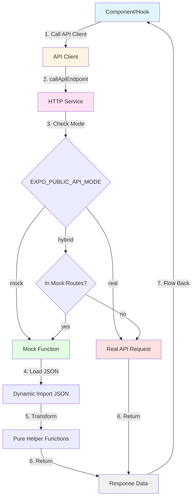

# Mock Implementation Guide

## Table of Contents

1. [Executive Summary](#executive-summary)
2. [Architecture Overview](#architecture-overview)
3. [Strategy for Creating Mocks](#strategy-for-creating-mocks)
4. [Strategy for Implementing and Calling Mocks](#strategy-for-implementing-and-calling-mocks)
5. [Best Practices and Patterns](#best-practices-and-patterns)
6. [Examples](#examples)
7. [Troubleshooting](#troubleshooting)

---

## Executive Summary

This document serves as the definitive guide for creating and implementing mocks in the Cloth-In-App codebase. It provides clear strategies and patterns for working with mocks following the established three-layer architecture.

> **Note**: For documentation on the refactoring changes that established these patterns, see `MOCK_REFACTORING_CHANGES.md`.

### Key Principles

1. **Centralized Data Access**: All data access flows through the endpoint layer, enabling seamless switching between mock and real APIs
2. **Separation of Concerns**: Pure helper functions handle transformations without importing JSON directly
3. **Type Safety**: Full TypeScript support throughout the mock layer
4. **Consistency**: All mocks follow the same pattern, making the codebase maintainable and predictable

### Architecture Pattern

```
Component/Hook → API Client → HTTP Service → Endpoint (Mock/Real)
```

This three-layer architecture ensures that:
- Components and hooks never directly import mock JSON files
- All data access goes through API clients
- The HTTP service routes requests to either mocks or real APIs based on environment configuration
- Endpoints define both the API contract and the mock implementation

---

## Architecture Overview

### 2.1 Three-Layer Architecture

The mock implementation follows a strict three-layer architecture:

```
┌─────────────────────────────────────────┐
│  Component/Hook (UI Layer)              │
│  - React components                      │
│  - Custom hooks                          │
│  - Never imports JSON directly           │
└──────────────┬──────────────────────────┘
               │
               │ Calls API Client methods
               ▼
┌─────────────────────────────────────────┐
│  API Client (Service Layer)             │
│  - Thin wrappers around endpoints       │
│  - Provides simple interface             │
│  - Example: userApiClient.getUser()     │
└──────────────┬──────────────────────────┘
               │
               │ Calls callApiEndpoint()
               ▼
┌─────────────────────────────────────────┐
│  HTTP Service (Routing Layer)          │
│  - callApiEndpoint() function            │
│  - Checks EXPO_PUBLIC_API_MODE          │
│  - Routes to mock or real API            │
└──────────────┬──────────────────────────┘
               │
        ┌──────┴──────┐
        │             │
        ▼             ▼
┌──────────────┐  ┌──────────────┐
│ Mock Function│  │ Real Backend │
│ (in endpoint)│  │ (HTTP request)│
└──────────────┘  └──────────────┘
```

### 2.2 Data Flow Diagram



### 2.3 Key Concepts

#### EndpointDefinition Pattern

Every endpoint is defined using the `EndpointDefinition` type:

```typescript
export type EndpointDefinition<RequestBodyType, ResponseBodyType> = {
  key: string;                    // Unique identifier, e.g., "fitpics.get"
  method: "GET" | "POST" | "PUT" | "PATCH" | "DELETE";
  pathTemplate: string;           // API route template, e.g., "/v1/fitpics/:fitpicId"
  auth?: "required" | "optional" | "none";
  mock?: (args: {
    body: RequestBodyType | undefined;
    pathParameters: Record<string, string>;
    queryParameters: Record<string, string>;
    headers: Record<string, string>;
  }) => Promise<ResponseBodyType> | ResponseBodyType;
};
```

#### API Client Pattern

API clients are thin wrappers that provide a simple interface:

```typescript
// src/services/apiClients/userClient.ts
import { callApiEndpoint } from "../http";
import { getUserEndpoint, GetUserResponse } from '../endpoints';

export async function getUser(userId: string) {
  return callApiEndpoint<undefined, GetUserResponse>(getUserEndpoint, {
    pathParameters: { userId },
  });
}

export const userApiClient = { getUser };
```

#### HTTP Service Routing

The HTTP service (`src/services/http.ts`) acts as a smart router:

1. Checks `EXPO_PUBLIC_API_MODE` environment variable
2. If `mock`: Always use mock function
3. If `real`: Always make HTTP request
4. If `hybrid`: Check if endpoint key is in `EXPO_PUBLIC_MOCK_ROUTES`

#### Mock Function Structure

Mock functions are async functions that:
1. Simulate network delay (200-800ms)
2. Load mock JSON data using dynamic imports
3. Transform data using pure helper functions
4. Return response matching the API contract

---

## Strategy for Creating Mocks

### 3.1 Where to Store Mock Data

**Location**: `src/mocks/` directory

**Naming Convention**: All mock data files use the `mock-*.json` prefix:
- `mock-users.json` - User data
- `mock-fitpics.json` - FitPic data
- `mock-products.json` - Product data
- `mock-session.json` - Session data

**Subdirectories**: For category-specific mocks:
- `src/mocks/profile/` - Profile-related mocks
- `src/mocks/search/` - Search-related mocks (if needed)

**Structure**: Mock JSON files should follow consistent structures:
- Arrays: `{ "fitpics": [...] }` or `{ "products": [...] }`
- Objects keyed by ID: `{ "u_1": {...}, "u_2": {...} }`

### 3.2 How to Import Mock Data

#### In Endpoints: Dynamic Imports

**Always use dynamic imports** within the `mock` function:

```typescript
// ✅ CORRECT - Dynamic import in endpoint
export const getFitPicEndpoint: EndpointDefinition<undefined, GetFitPicResponse> = {
  key: "fitpics.get",
  method: "GET",
  pathTemplate: "/v1/fitpics/:fitpicId",
  mock: async ({ pathParameters }) => {
    // Dynamic import - loaded lazily
    const fitpicsData = (await import("../../../mocks/mock-fitpics.json")).default;
    const usersData = (await import("../../../mocks/mock-users.json")).default;
    
    // Use the data...
    const fitpic = fitpicsData.fitpics.find(fp => fp.id === pathParameters.fitpicId);
    return { success: true, fitpic };
  },
};
```

**Why dynamic imports?**
- Lazy loading: Data is only loaded when the mock function is called
- Code splitting: Reduces initial bundle size
- Consistency: All endpoints use the same pattern

#### In Utilities: Lazy Require (Special Case)

**Only for synchronous utilities used by endpoints**:

```typescript
// ✅ CORRECT - Lazy require in mockSessionUsers.ts
let usersDataSync: Record<string, RawUser> | null = null;

function ensureUsersDataLoaded(): Record<string, RawUser> {
  if (!usersDataSync) {
    const data = require("../mocks/mock-users.json");
    usersDataSync = data as Record<string, RawUser>;
  }
  return usersDataSync;
}
```

**When to use `require()`:**
- Only in utilities that need synchronous access
- Only when used by endpoints (which are allowed to import JSON)
- Example: `mockSessionUsers.ts` needs synchronous access for `getCurrentUserId()`

#### Never: Direct Static Imports Outside Endpoints

```typescript
// ❌ WRONG - Direct import in service/hook/component
import fitpicsData from '../mocks/mock-fitpics.json';  // DON'T DO THIS

// ❌ WRONG - Static import at module level in endpoint
import fitpicsData from '../mocks/mock-fitpics.json';  // Use dynamic import instead
```

### 3.3 What the Mock Should Include

#### Basic Endpoint Structure

Every endpoint definition should include:

```typescript
export const myEndpoint: EndpointDefinition<RequestType, ResponseType> = {
  key: "category.action",           // Unique identifier
  method: "GET",                     // HTTP method
  pathTemplate: "/v1/category/:id",  // API route template
  auth: "optional",                  // Auth policy: "required" | "optional" | "none"
  mock: async ({                     // Mock function
    body,
    pathParameters,
    queryParameters,
    headers,
  }) => {
    // Implementation...
  },
};
```

#### Mock Function Requirements

1. **Simulate Network Delay**
   ```typescript
   await new Promise((resolve) => setTimeout(resolve, 250)); // 200-800ms typical
   ```

2. **Handle Request Parameters**
   ```typescript
   const userId = pathParameters.userId;
   const query = queryParameters.q;
   const requestBody = body as MyRequestType;
   ```

3. **Load Mock Data**
   ```typescript
   const data = (await import("../../../mocks/mock-data.json")).default;
   ```

4. **Transform Data Using Pure Helpers**
   ```typescript
   const transformed = transformRawData(data.items, userData, products);
   ```

5. **Handle Edge Cases**
   ```typescript
   if (!item) {
     return { success: false, error: "Item not found" };
   }
   ```

6. **Return Proper Response Format**
   ```typescript
   return { success: true, data: transformed };
   ```

### 3.4 Scenarios and Examples

#### Scenario 1: Simple GET Endpoint

Fetch a single resource by ID:

```typescript
// src/services/endpoints/content/getProduct.ts
export const getProductEndpoint: EndpointDefinition<undefined, GetProductResponse> = {
  key: "content.getProduct",
  method: "GET",
  pathTemplate: "/v1/products/:productId",
  auth: "optional",
  mock: async ({ pathParameters }) => {
    await new Promise((resolve) => setTimeout(resolve, 300));
    
    const productId = pathParameters.productId;
    const data = (await import("../../../mocks/mock-products.json")).default;
    
    const product = data.products.find((p: any) => p.id === productId);
    
    if (!product) {
      return { success: false, error: "Product not found" };
    }
    
    return { success: true, product };
  },
};
```

#### Scenario 2: GET with Filtering

Query parameters for filtering:

```typescript
// src/services/endpoints/fitpics/getFitPics.ts
export const getFitPicsEndpoint: EndpointDefinition<undefined, GetFitPicsResponse> = {
  key: "fitpics.list",
  method: "GET",
  pathTemplate: "/v1/fitpics",
  auth: "optional",
  mock: async ({ queryParameters }) => {
    await new Promise((resolve) => setTimeout(resolve, 400));
    
    const userId = queryParameters.user_id;
    const limit = parseInt(queryParameters.limit || "20");
    
    // Load data
    const fitpicsData = (await import("../../../mocks/mock-fitpics.json")).default;
    const usersData = (await import("../../../mocks/mock-users.json")).default;
    
    let fitpics = [...fitpicsData.fitpics];
    
    // Filter by user if provided
    if (userId) {
      const userData = usersData[userId as keyof typeof usersData];
      const postedIds = userData?.fitpics?.postedIds;
      
      if (postedIds && Array.isArray(postedIds)) {
        fitpics = fitpics.filter(fp => postedIds.includes(fp.id));
      } else {
        fitpics = fitpics.filter(fp => fp.authorId === userId);
      }
    }
    
    // Transform using pure helper
    const transformed = fitpics
      .slice(0, limit)
      .map(fp => transformRawFitPic(fp, usersData[fp.author], productsData.products))
      .filter((fp): fp is FitPic => fp !== null);
    
    return { fitpics: transformed };
  },
};
```

#### Scenario 3: POST Endpoint with In-Memory Storage

Create resource with stateful storage:

```typescript
// src/services/endpoints/fitpics/createFitPic.ts

// Module-scoped in-memory store
const inMemoryFitpics: FitPic[] = [];

export const createFitPicEndpoint: EndpointDefinition<CreateFitPicRequest, CreateFitPicResponse> = {
  key: "fitpics.create",
  method: "POST",
  pathTemplate: "/v1/fitpics",
  auth: "optional",
  mock: async ({ body }) => {
    await new Promise((resolve) => setTimeout(resolve, 400));
    
    if (!body) {
      return { success: false, error: "Missing request body" };
    }
    
    const request = body as CreateFitPicRequest;
    
    // Create new fitpic
    const fitpic: FitPic = {
      id: generateId("fp"),
      authorId: getCurrentUser()?.id ?? "u_demo",
      // ... other fields
    };
    
    // Store in memory
    inMemoryFitpics.push(fitpic);
    
    return { success: true, fitpic };
  },
};
```

#### Scenario 4: Complex Endpoint with Multiple Data Sources

Multiple JSON files and transformations:

```typescript
// src/services/endpoints/fitpics/getFitPic.ts
export const getFitPicEndpoint: EndpointDefinition<undefined, GetFitPicResponse> = {
  key: "fitpics.get",
  method: "GET",
  pathTemplate: "/v1/fitpics/:fitpicId",
  auth: "optional",
  mock: async ({ pathParameters }) => {
    await new Promise((resolve) => setTimeout(resolve, 250));
    
    const id = pathParameters.fitpicId;
    
    // Check in-memory first (for newly created fitpics)
    const inMemoryFitpic = inMemoryFitpics.find((fp) => fp.id === id);
    if (inMemoryFitpic) {
      return { success: true, fitpic: inMemoryFitpic };
    }
    
    // Load multiple data sources
    const fitpicsData = (await import("../../../mocks/mock-fitpics.json")).default;
    const usersData = (await import("../../../mocks/mock-users.json")).default;
    const productsData = (await import("../../../mocks/mock-products.json")).default;
    
    // Find raw data
    const rawFitpic = fitpicsData.fitpics.find((fp: any) => fp.id === id);
    if (!rawFitpic) {
      return { success: false, error: "FitPic not found" };
    }
    
    // Transform using pure helper
    const userData = usersData[rawFitpic.author as keyof typeof usersData];
    const fitpic = transformRawFitPic(rawFitpic, userData, productsData.products);
    
    if (!fitpic) {
      return { success: false, error: "FitPic transformation failed" };
    }
    
    return { success: true, fitpic };
  },
};
```

---

## Strategy for Implementing and Calling Mocks

### 4.1 Creating a New Endpoint

**Step-by-step guide:**

1. **Create endpoint file** in `src/services/endpoints/{category}/{name}.ts`
   ```typescript
   // src/services/endpoints/users/getUserProfile.ts
   import type { EndpointDefinition } from "../../http";
   
   export type GetUserProfileResponse = {
     profile: {
       // ... type definition
     };
   };
   
   export const getUserProfileEndpoint: EndpointDefinition<undefined, GetUserProfileResponse> = {
     key: "users.getProfile",
     method: "GET",
     pathTemplate: "/v1/users/:userId/profile",
     auth: "optional",
     mock: async ({ pathParameters }) => {
       // Implementation...
     },
   };
   ```

2. **Export endpoint** from category index
   ```typescript
   // src/services/endpoints/users/index.ts
   export * from "./getUserProfile";
   ```

3. **Add to main endpoints index** (if needed)
   ```typescript
   // src/services/endpoints/index.ts
   export * from "./users";
   ```

### 4.2 Creating an API Client

**Step-by-step guide:**

1. **Create/update client** in `src/services/apiClients/{name}Client.ts`
   ```typescript
   // src/services/apiClients/userClient.ts
   import { callApiEndpoint } from "../http";
   import { getUserProfileEndpoint, GetUserProfileResponse } from '../endpoints';
   
   export async function getUserProfile(userId: string) {
     return callApiEndpoint<undefined, GetUserProfileResponse>(
       getUserProfileEndpoint,
       {
         pathParameters: { userId },
       }
     );
   }
   ```

2. **Export client object**
   ```typescript
   export const userApiClient = {
     getUser,
     getUserProfile,  // Add new method
     // ... other methods
   };
   ```

### 4.3 Using in Components/Hooks

**Step-by-step guide:**

1. **Import API client**
   ```typescript
   import { userApiClient } from '../services/apiClients/userClient';
   ```

2. **Call client method**
   ```typescript
   const response = await userApiClient.getUserProfile(userId);
   ```

3. **Handle async response**
   ```typescript
   if (response.profile) {
     setProfile(response.profile);
   }
   ```

4. **Never import JSON directly**
   ```typescript
   // ❌ DON'T DO THIS
   import userData from '../mocks/mock-users.json';
   ```

**Example in a hook:**

```typescript
// src/hooks/useUserProfile.ts
import { useState, useEffect } from 'react';
import { userApiClient } from '../services/apiClients/userClient';

export function useUserProfile(userId: string) {
  const [profile, setProfile] = useState(null);
  const [loading, setLoading] = useState(true);
  const [error, setError] = useState(null);

  useEffect(() => {
    async function load() {
      try {
        const response = await userApiClient.getUserProfile(userId);
        if (response.profile) {
          setProfile(response.profile);
        }
      } catch (e) {
        setError(e);
      } finally {
        setLoading(false);
      }
    }
    load();
  }, [userId]);

  return { profile, loading, error };
}
```

### 4.4 Pure Helper Functions

**When to create:**
- Complex transformations that are reused across multiple endpoints
- Data filtering or sorting logic
- Type conversions
- Any logic that operates on data without needing to import JSON

**Where to store:**
- `src/services/{category}Utils.ts` - Category-specific utilities
- `src/utils/` - General utilities

**Rules:**
- ✅ Accept data as parameters
- ✅ Return transformed data
- ✅ No side effects (pure functions)
- ❌ Never import JSON files
- ❌ Never mutate input data

**Example:**

```typescript
// src/services/fitpicUtils.ts
export function transformRawFitPic(
  rawFitpic: any,
  userData: any,
  products: any[]
): FitPic | null {
  // Transform raw data to FitPic type
  // Accepts data as parameters - no JSON imports
  // ...
}
```

**Usage in endpoint:**

```typescript
// In endpoint mock function
const fitpicsData = (await import("../../../mocks/mock-fitpics.json")).default;
const usersData = (await import("../../../mocks/mock-users.json")).default;
const productsData = (await import("../../../mocks/mock-products.json")).default;

const fitpic = transformRawFitPic(
  rawFitpic,
  usersData[rawFitpic.author],
  productsData.products
);
```

---

## Best Practices and Patterns

### 5.1 Do's and Don'ts

#### ✅ DO

- **Use dynamic imports in endpoints**
  ```typescript
  const data = (await import("../../../mocks/mock-data.json")).default;
  ```

- **Create pure helper functions**
  ```typescript
  export function transformData(raw: any): TransformedType {
    // Pure function - no JSON imports
  }
  ```

- **Use API clients in components/hooks**
  ```typescript
  const response = await userApiClient.getUser(userId);
  ```

- **Simulate realistic network delays**
  ```typescript
  await new Promise((resolve) => setTimeout(resolve, 250));
  ```

- **Handle edge cases**
  ```typescript
  if (!item) {
    return { success: false, error: "Not found" };
  }
  ```

- **Use TypeScript types**
  ```typescript
  export type GetUserResponse = {
    user: { /* ... */ };
  };
  ```

#### ❌ DON'T

- **Import JSON outside endpoints**
  ```typescript
  // ❌ DON'T DO THIS
  import data from '../mocks/mock-data.json';
  ```

- **Mutate mock data**
  ```typescript
  // ❌ DON'T DO THIS
  fitpicsData.fitpics.push(newFitpic);  // Mutates original data
  ```

- **Create services that bypass endpoints**
  ```typescript
  // ❌ DON'T DO THIS
  export function getFitPic(id: string) {
    const data = require('../mocks/mock-fitpics.json');
    return data.fitpics.find(fp => fp.id === id);
  }
  ```

- **Use static imports in endpoints**
  ```typescript
  // ❌ DON'T DO THIS
  import fitpicsData from '../mocks/mock-fitpics.json';
  
  export const endpoint = {
    mock: async () => {
      return fitpicsData;  // Use dynamic import instead
    },
  };
  ```

- **Forget to simulate network delay**
  ```typescript
  // ❌ DON'T DO THIS
  mock: async () => {
    return data;  // Missing delay simulation
  }
  ```

### 5.2 Common Patterns

#### Pattern 1: In-Memory State for Stateful Endpoints

For endpoints that create/update resources, use module-scoped storage:

```typescript
// Module-scoped array
const inMemoryFitpics: FitPic[] = [];

export const createFitPicEndpoint = {
  mock: async ({ body }) => {
    const fitpic = createFitPicFromRequest(body);
    inMemoryFitpics.push(fitpic);  // Store in memory
    return { success: true, fitpic };
  },
};

// Check in-memory first in GET endpoints
export const getFitPicEndpoint = {
  mock: async ({ pathParameters }) => {
    const inMemory = inMemoryFitpics.find(fp => fp.id === id);
    if (inMemory) return { success: true, fitpic: inMemory };
    
    // Fall back to static JSON...
  },
};
```

#### Pattern 2: Data Transformation Pipeline

Transform raw JSON through pure functions:

```typescript
mock: async ({ pathParameters }) => {
  // 1. Load raw data
  const rawData = (await import("../../../mocks/mock-data.json")).default;
  
  // 2. Filter
  const filtered = rawData.items.filter(/* ... */);
  
  // 3. Transform using pure helper
  const transformed = filtered.map(item => transformItem(item, relatedData));
  
  // 4. Sort
  const sorted = sortItems(transformed, sortOption);
  
  // 5. Return
  return { items: sorted };
}
```

#### Pattern 3: Error Handling

Return error responses matching API format:

```typescript
mock: async ({ pathParameters }) => {
  const item = findItem(pathParameters.id);
  
  if (!item) {
    return {
      success: false,
      error: "Item not found",
      errorCode: "NOT_FOUND",
    };
  }
  
  return { success: true, item };
}
```

#### Pattern 4: Type Safety

Use TypeScript types throughout:

```typescript
export type GetUserRequest = {
  userId: string;
};

export type GetUserResponse = {
  success: boolean;
  user?: {
    id: string;
    username: string;
    // ...
  };
  error?: string;
};

export const getUserEndpoint: EndpointDefinition<
  GetUserRequest,
  GetUserResponse
> = {
  // ...
};
```

### 5.3 Testing Considerations

#### Testing Endpoints

```typescript
describe('getUserEndpoint', () => {
  it('should return user data', async () => {
    const result = await getUserEndpoint.mock({
      pathParameters: { userId: 'u_1' },
      queryParameters: {},
      headers: {},
      body: undefined,
    });
    
    expect(result.success).toBe(true);
    expect(result.user).toBeDefined();
  });
});
```

#### Testing API Clients

```typescript
describe('userApiClient', () => {
  it('should call endpoint correctly', async () => {
    const result = await userApiClient.getUser('u_1');
    expect(result.user).toBeDefined();
  });
});
```

#### Testing Components with Mocks

Set environment variable to use mocks:

```typescript
// In test setup
process.env.EXPO_PUBLIC_API_MODE = 'mock';

// Component will automatically use mocks
const { result } = renderHook(() => useUserProfile('u_1'));
expect(result.current.profile).toBeDefined();
```

---

## Examples

### 6.1 Complete Example: Creating a New Endpoint

**Full walkthrough from endpoint → client → hook → component**

#### Step 1: Create Endpoint

```typescript
// src/services/endpoints/users/getUserPosts.ts
import type { EndpointDefinition } from "../../http";

export type GetUserPostsResponse = {
  posts: Array<{
    id: string;
    title: string;
    content: string;
    createdAt: string;
  }>;
  total: number;
};

export const getUserPostsEndpoint: EndpointDefinition<
  undefined,
  GetUserPostsResponse
> = {
  key: "users.getPosts",
  method: "GET",
  pathTemplate: "/v1/users/:userId/posts",
  auth: "optional",
  mock: async ({ pathParameters, queryParameters }) => {
    await new Promise((resolve) => setTimeout(resolve, 300));
    
    const userId = pathParameters.userId;
    const limit = parseInt(queryParameters.limit || "20");
    const offset = parseInt(queryParameters.offset || "0");
    
    // Load mock data
    const usersData = (await import("../../../mocks/mock-users.json")).default;
    const user = usersData[userId as keyof typeof usersData];
    
    if (!user) {
      return { posts: [], total: 0 };
    }
    
    // Get user's posts (assuming posts are stored in user data)
    const allPosts = user.posts || [];
    const posts = allPosts.slice(offset, offset + limit);
    
    return {
      posts: posts.map((post: any) => ({
        id: post.id,
        title: post.title,
        content: post.content,
        createdAt: post.createdAt,
      })),
      total: allPosts.length,
    };
  },
};
```

#### Step 2: Export Endpoint

```typescript
// src/services/endpoints/users/index.ts
export * from "./getUserPosts";
```

#### Step 3: Create API Client Method

```typescript
// src/services/apiClients/userClient.ts
import { getUserPostsEndpoint, GetUserPostsResponse } from '../endpoints';

export async function getUserPosts(
  userId: string,
  limit?: number,
  offset?: number
) {
  return callApiEndpoint<undefined, GetUserPostsResponse>(
    getUserPostsEndpoint,
    {
      pathParameters: { userId },
      queryParameters: {
        limit: limit?.toString(),
        offset: offset?.toString(),
      },
    }
  );
}

export const userApiClient = {
  getUser,
  getUserPosts,  // Add new method
  // ...
};
```

#### Step 4: Create Hook

```typescript
// src/hooks/useUserPosts.ts
import { useState, useEffect } from 'react';
import { userApiClient } from '../services/apiClients/userClient';

export function useUserPosts(userId: string) {
  const [posts, setPosts] = useState([]);
  const [loading, setLoading] = useState(true);
  const [error, setError] = useState(null);

  useEffect(() => {
    async function load() {
      try {
        const response = await userApiClient.getUserPosts(userId);
        setPosts(response.posts);
      } catch (e) {
        setError(e);
      } finally {
        setLoading(false);
      }
    }
    load();
  }, [userId]);

  return { posts, loading, error };
}
```

#### Step 5: Use in Component

```typescript
// components/user/UserPosts.tsx
import { useUserPosts } from '../../hooks/useUserPosts';

export function UserPosts({ userId }: { userId: string }) {
  const { posts, loading, error } = useUserPosts(userId);

  if (loading) return <Text>Loading...</Text>;
  if (error) return <Text>Error: {error.message}</Text>;

  return (
    <View>
      {posts.map(post => (
        <View key={post.id}>
          <Text>{post.title}</Text>
          <Text>{post.content}</Text>
        </View>
      ))}
    </View>
  );
}
```

### 6.2 Example: Refactoring Existing Code

**Before/after comparison showing migration pattern**

#### Before: Direct JSON Import

```typescript
// ❌ OLD WAY
// src/services/fitpicApi.ts
import fitpicsData from '../mocks/mock-fitpics.json';
import usersData from '../mocks/mock-users.json';

export const getFitPicById = async (id: string) => {
  await delay(400);
  const fitpic = fitpicsData.fitpics.find(fp => fp.id === id);
  const user = usersData[fitpic.author];
  return { fitpic, user };
};
```

#### After: Endpoint Pattern

```typescript
// ✅ NEW WAY
// src/services/endpoints/fitpics/getFitPic.ts
export const getFitPicEndpoint: EndpointDefinition<undefined, GetFitPicResponse> = {
  key: "fitpics.get",
  method: "GET",
  pathTemplate: "/v1/fitpics/:fitpicId",
  auth: "optional",
  mock: async ({ pathParameters }) => {
    await new Promise((resolve) => setTimeout(resolve, 400));
    
    const fitpicsData = (await import("../../../mocks/mock-fitpics.json")).default;
    const usersData = (await import("../../../mocks/mock-users.json")).default;
    
    const rawFitpic = fitpicsData.fitpics.find((fp: any) => fp.id === pathParameters.fitpicId);
    if (!rawFitpic) {
      return { success: false, error: "FitPic not found" };
    }
    
    const userData = usersData[rawFitpic.author as keyof typeof usersData];
    const fitpic = transformRawFitPic(rawFitpic, userData, productsData.products);
    
    return { success: true, fitpic };
  },
};

// src/services/apiClients/fitpicClient.ts
export async function getById(id: string) {
  return callApiEndpoint<undefined, GetFitPicResponse>(
    getFitPicEndpoint,
    { pathParameters: { fitpicId: id } }
  );
}
```

#### Migration Checklist

- [ ] Move logic from service to endpoint mock function
- [ ] Convert static imports to dynamic imports
- [ ] Extract transformations to pure helper functions
- [ ] Create/update API client method
- [ ] Update components/hooks to use API client
- [ ] Remove old service file (if no longer needed)

---

## Troubleshooting

### 7.1 Common Issues

#### Issue 1: Mock Not Being Called

**Symptoms**: Real API is being called instead of mock

**Solutions**:
1. Check `EXPO_PUBLIC_API_MODE` environment variable
   ```bash
   # Should be set to "mock"
   EXPO_PUBLIC_API_MODE=mock
   ```

2. Verify endpoint has a `mock` function defined
   ```typescript
   export const myEndpoint = {
     key: "category.action",
     mock: async () => { /* ... */ },  // Must be present
   };
   ```

3. Check endpoint key matches in hybrid mode
   ```bash
   # If using hybrid mode
   EXPO_PUBLIC_API_MODE=hybrid
   EXPO_PUBLIC_MOCK_ROUTES=category.action,other.endpoint
   ```

#### Issue 2: Type Errors

**Symptoms**: TypeScript errors when using endpoints

**Solutions**:
1. Ensure request/response types are properly defined
   ```typescript
   export type MyResponse = {
     success: boolean;
     data?: MyData;
   };
   
   export const myEndpoint: EndpointDefinition<MyRequest, MyResponse> = {
     // ...
   };
   ```

2. Use correct generic types in `callApiEndpoint`
   ```typescript
   callApiEndpoint<MyRequest, MyResponse>(myEndpoint, { /* ... */ });
   ```

#### Issue 3: Data Not Loading

**Symptoms**: Empty responses or undefined data

**Solutions**:
1. Check mock JSON file structure matches expectations
   ```typescript
   // If JSON is { "items": [...] }
   const data = (await import("../../../mocks/mock-data.json")).default;
   const items = data.items;  // Access .items property
   ```

2. Verify path parameters are correct
   ```typescript
   // In endpoint
   const id = pathParameters.userId;  // Must match pathTemplate :userId
   
   // In client
   callApiEndpoint(endpoint, {
     pathParameters: { userId: "u_1" },  // Key must match
   });
   ```

3. Check for null/undefined handling
   ```typescript
   const item = data.items.find(i => i.id === id);
   if (!item) {
     return { success: false, error: "Not found" };
   }
   ```

#### Issue 4: Performance Issues

**Symptoms**: Slow loading or large bundle size

**Solutions**:
1. Use dynamic imports (not static imports)
   ```typescript
   // ✅ Good - lazy loading
   const data = (await import("../../../mocks/mock-data.json")).default;
   
   // ❌ Bad - loaded at module initialization
   import data from '../../../mocks/mock-data.json';
   ```

2. Load only needed data
   ```typescript
   // Load multiple files in parallel
   const [fitpicsData, usersData, productsData] = await Promise.all([
     import("../../../mocks/mock-fitpics.json"),
     import("../../../mocks/mock-users.json"),
     import("../../../mocks/mock-products.json"),
   ]);
   ```

### 7.2 Debugging Tips

#### Verify Mock is Being Used

Add logging to mock function:

```typescript
mock: async ({ pathParameters }) => {
  console.log('[MOCK] getUserEndpoint called with:', pathParameters);
  // ... rest of implementation
}
```

#### Check Data Flow

Trace the call chain:

1. Component calls API client
2. API client calls `callApiEndpoint`
3. HTTP service checks mode and routes to mock
4. Mock function executes
5. Response flows back

#### Environment Variable Configuration

**Development (.env.local)**:
```bash
EXPO_PUBLIC_API_MODE=mock
EXPO_PUBLIC_API_URL=http://127.0.0.1:8080
EXPO_PUBLIC_MOCK_LATENCY_MS=400
```

**Testing**:
```bash
EXPO_PUBLIC_API_MODE=hybrid
EXPO_PUBLIC_MOCK_ROUTES=auth.signup,users.get
```

**Production**:
```bash
EXPO_PUBLIC_API_MODE=real
EXPO_PUBLIC_API_URL=https://api.example.com
```

---

## Conclusion

This guide documents the complete mock implementation architecture and provides clear strategies for creating and using mocks in the Cloth-In-App codebase. By following these patterns, developers can:

- Create consistent, maintainable mock implementations
- Easily switch between mock and real APIs
- Write testable, type-safe code
- Understand the data flow through the application

For questions or clarifications, refer to the existing endpoint implementations in `src/services/endpoints/` as reference examples.

